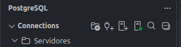
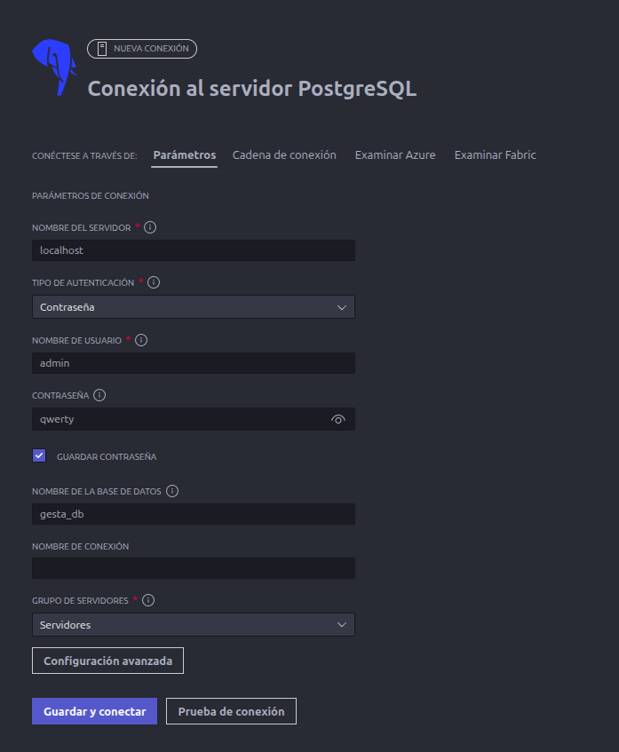
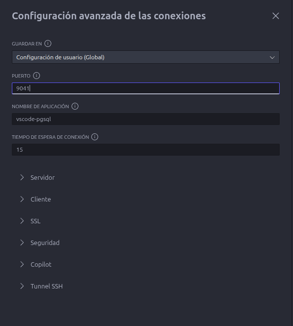
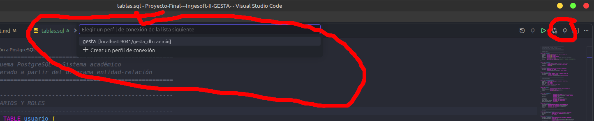
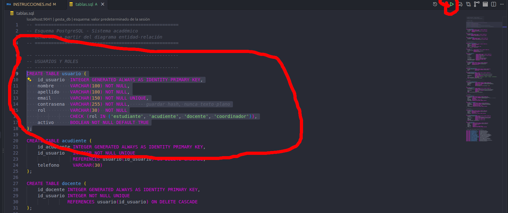

### DOCKER
Si están usando terminal desde wsl.

sudo docker compose up -d

si están usando windows

docker compose up -d

### ACCEDER

Pueden utilizar Dbeaver, pgadmin o la extensión de vscode con el siguiente id:
*ms-ossdata.vscode-pgsql*

Pueden pegarla en el buscador de extensiones.

Luego, para añadir conexión, le dan al botón que les diga agregar conexión, o el del enchufe con el símbolo "+".

Luego. llenan el formulario de la siguiente manera. El apartado de nombre de la conexión lo pueden dejar como gusten.

Luego deben darle click al botón de *configuración avanzada*. Esto les dará la ventana donde deben colocar el puerto *9041*. 

### ARCHIVO SQL.

Primero, al entrar al archivo *tablas.sql* se debe seleccionar la base de datos a la que se le van a hacer cambios.

Para crear las tablas del archivo *tablas.sql* deben seleccionar el texto de la tabla y ejecutarlo individualmente, así para cada tabla o comando separado por comas.

